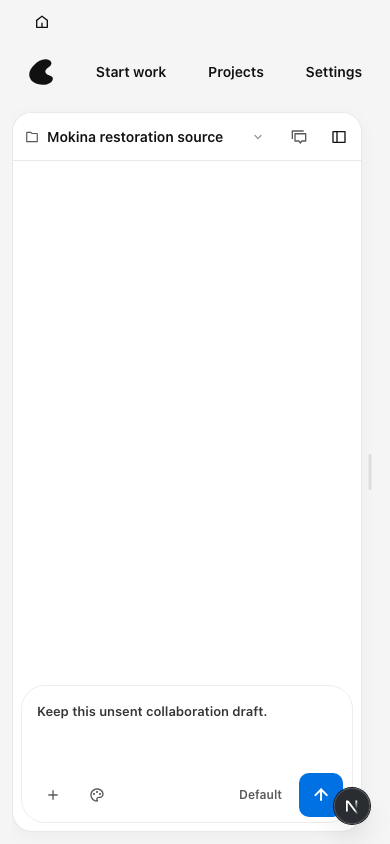
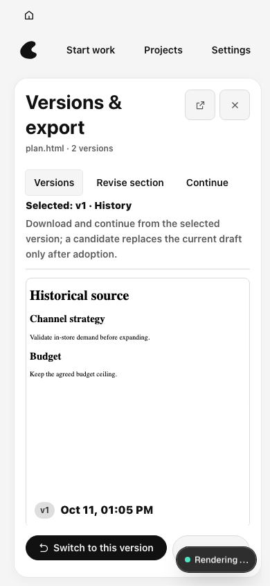

# 最终验收发现的后续修复

## 固定来源回跳在小窗口不可读

最终 CI `38111602338`（a417f6c5）44 项通过，390×844 的 P08 → 历史来源回跳失败，首轮与重试一致。相同源码在本机原有真实 daemon 流程复现：URL 和所选 v1 身份正确，项目切换却重置为对话布局，成果区被挤出视口。原断言能找到文字，但其布局为隐藏。

修复沿用 `workspaceFocused`：明确带版本的 Mokina 文件路由进入成果阅读布局；普通打开项目的讨论默认行为保留。同名文件或同版本 ID 的跨项目导航也重新应用路由。没有新增状态来源。

原失败用例增强为版本身份必须位于视口，且历史 HTML 正文确实可读。1440×900、1280×720、900×600、390×844 四种尺寸均通过；回跳前后保留原未发送讨论与修订/接续草稿。最终提交的复跑和 CI 以交付记录为准。

同数据、同视口 390×844：

## 原生保存选项核验

0.0.4-local.5 的实际原生测试已证明迁移、P05 草稿、完整退出/重启后的 P07 草稿恢复、v1 HTML 保存与冻结摘要一致。随后 HTML 保存对话框的保存按钮不可用，正式稿与候选稿均受影响，重新选择目录、文件名及冷启动未解除。该候选尚不能验收。

已确认的实现差异：HTML 与恢复 ZIP 没有经过现有 `saveAsDialogOptionsForFilename`，而 PDF/PPTX/图片经过统一保存选项。此轮将 HTML/ZIP 纳入同一保存入口，保留文件名，声明对应格式和 All Files，沿用 dontAddToRecent；新增两个红绿用例，原有六个用例保留并通过。

这项源码检查不证明原生故障已经解决。下一候选为 0.0.4-local.6，须重新实际保存 HTML、候选版本及完整恢复 ZIP；若仍失败，保留失败证据继续定位，不以测试通过替代验收。
