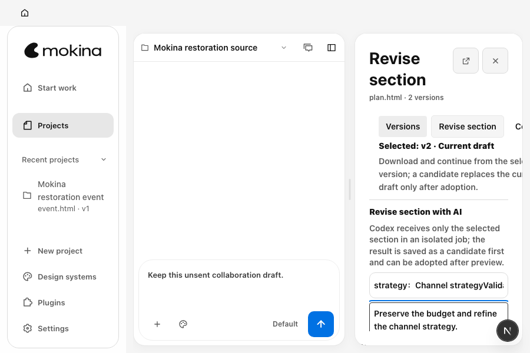
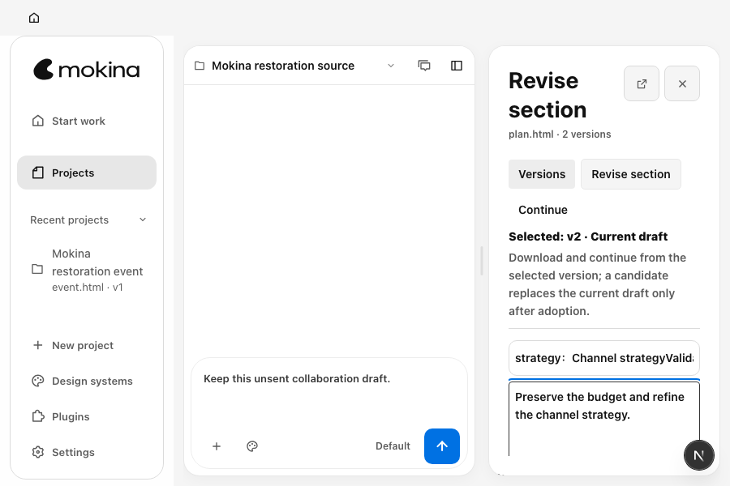
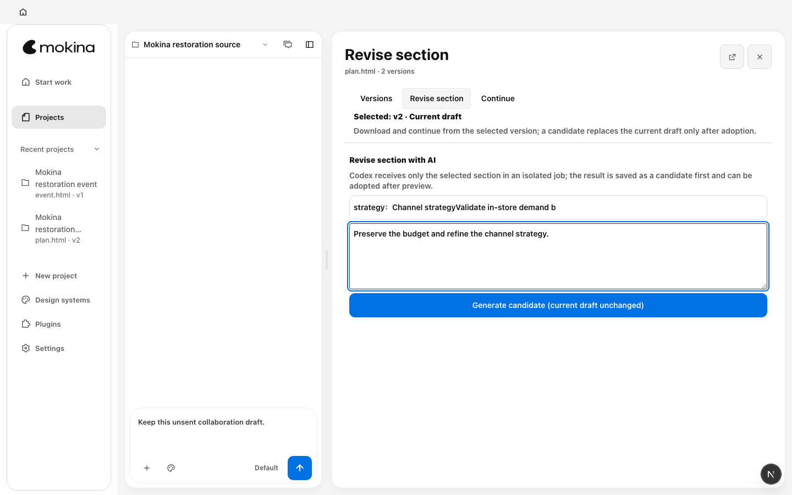

# P05 窄窗口溢出修复与验收

2026-10-11。基线 `ec0b73bf` 的 CI 在 900×600 进入章节修订时失败：面板宽 284px，内容宽 345px，横向溢出 61px。本次本地重现相同值；修复后 P05/P06/P07 均为 0px。侧栏恢复入口仍可达，未回退 R02 的窄窗口侧栏规则。

## 原因与改动

真实 DOM 显示，版本身份区域的 `Versions / Revise section / Continue` 导航行宽 304.75px，右边界 947.75px，超出 900px 视口。未限制最小宽度的 grid 轨道被这行按钮撑大，连带版本身份与说明文字溢出；章节选择和输入框不是溢出来源。

`MokinaArtifactActions.module.css` 仅增加 12 行：context 单列使用 `minmax(0, 1fr)`、允许自身收缩；仅 context 内的导航按钮换行；面板容器宽度不超过 360px 时取消 context 的重复左右内边距，仍保留面板自身 24px 内边距。字体、按钮文字、版本语义、Read 主工具栏和 R02 侧栏规则保持原样。未通过隐藏或裁剪内容消除溢出。

## 同数据、同视口对照

前后均使用现有 `mokina-page-restoration.test.ts` 的 `Mokina restoration source` 合成项目、`plan.html` 当前 v2、`strategy` 章节及要求：`Preserve the budget and refine the channel strategy.`。动作顺序相同：打开 P05、选择章节、填入要求、截图；保留 fill 后的自然焦点滚动。修复后固定头部变高，表单因此处于不同自然滚动位置，未人为调整截图掩盖变化。

| 视口 | 修复前 | 修复后 |
| --- | --- | --- |
| 900×600 |  |  |
| 1440×900 |  |  |

[实际 DOM 和操作几何](evidence/p05-width-geometry.json)记录了修复前溢出子项及修复后的面板、滚动区域和操作命中。

## 行为验证

Node `v24.15.0`，独立 tools-dev namespace、隔离合成数据，两个 worker。运行既有 P01–P08 完整流程及 R02 恢复包导出/导入流程，各覆盖 900×600 和 1440×900：**4/4 通过，无重试、无跳过**。

```sh
cd open-design
PATH="/Users/dingcheng/.local/share/fnm/node-versions/v24.15.0/installation/bin:$PATH" \
OD_PLAYWRIGHT_FULLY_PARALLEL=1 corepack pnpm --filter @open-design/e2e exec playwright test \
  -c playwright.config.ts ui/mokina-page-restoration.test.ts ui/mokina-recovery-integrity.test.ts \
  --grep 'at (900|1440)$' --workers=2
```

既有 `scrollWidth - clientWidth <= 1` 断言未放宽。900px 下 P05/P06/P07 均为 `284 - 284 = 0`；1440px 下均为 `824 - 824 = 0`。用例走完 P08 及来源版本返回，P05/P07 草稿仍各自保留，未产生额外项目或 run 请求。R02 两条用例仍通过真实侧栏进入恢复操作，验证部分恢复包需明确选择后导出，并在导入后保留部分恢复提示。

本轮临时采集还通过 Playwright 正常滚动和 `click({ trial: true })` 验证操作命中，未发起生成或继续制作：

| 900×600 操作 | 操作位置 | 滚动与命中 |
| --- | --- | --- |
| P05 生成候选 | y=511.875，宽236，高44 | 现有 body 高145.5、内容高352，scrollTop=206；中心命中为 true |
| P06 下载 | y=519，宽108，高44 | 固定底部操作，中心命中为 true |
| P07 创建继续制作项目 | y=491.64，宽196，高44 | 现有 body 高181.5、内容高915，scrollTop=733；中心命中为 true |

两个视口的三个页面均通过 Close 按钮正常命中检查。1440px 操作无需滚动；查看宽窗口截图未发现布局退化。临时 DOM 采集及 trial 检查已从测试源文件撤回，保留在原始证据中的补丁；最终测试源文件与基线一致。本次没有增加重复测试或第二套布局状态。

## 证据与清理

原始日志、JSON 报告和临时采集补丁保存在 `output/mokina-m0-2026-10-11/p05-width-*`；最终结果为 `p05-width-final.log` 和 `p05-width-final-results.json`。扩展基线报告为 `p05-width-expanded-baseline-results.json`（3 通过、900px P05 失败），最终报告才代表修复后的代码。

所有测试均由既有 fixture 的 `stopWeb()` 停止 daemon/web。保存失败日志后，核验本轮失败 runtime 的 6 个端口关闭，并移除 3 份合成数据/runtime；成功 runtime 已自动移除，再核验对应 worker 退出并删除本轮空 namespace 目录。结果记录在 `p05-width-cleanup.json`。本次没有创建原生应用副本、挂载镜像或 LaunchServices 注册，未触碰用户数据。

本记录证明源码浏览器流程与窄窗口修复；最终提交 CI、候选重建和原生验收由主任务绑定新提交后完成，旧 `ec0b73bf` 候选不能代表本次 CSS 修复。
