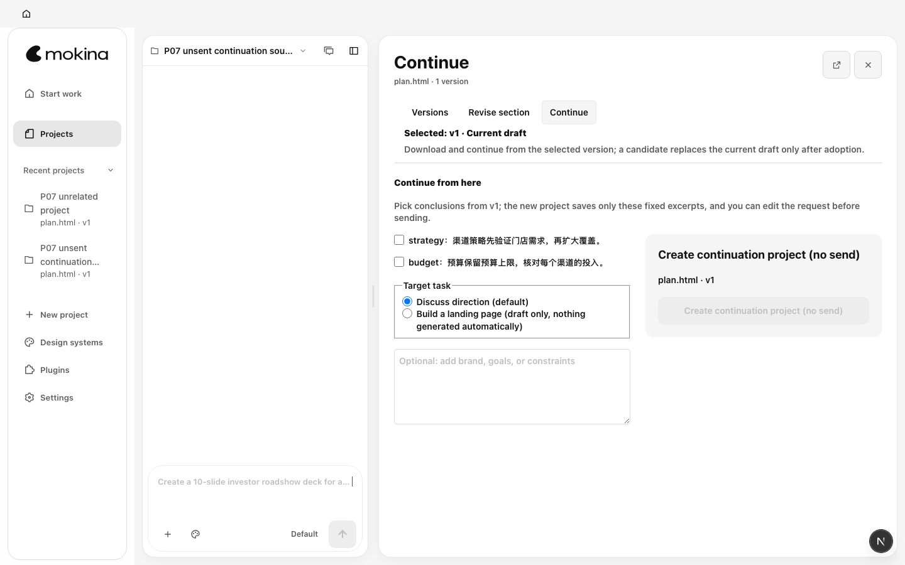
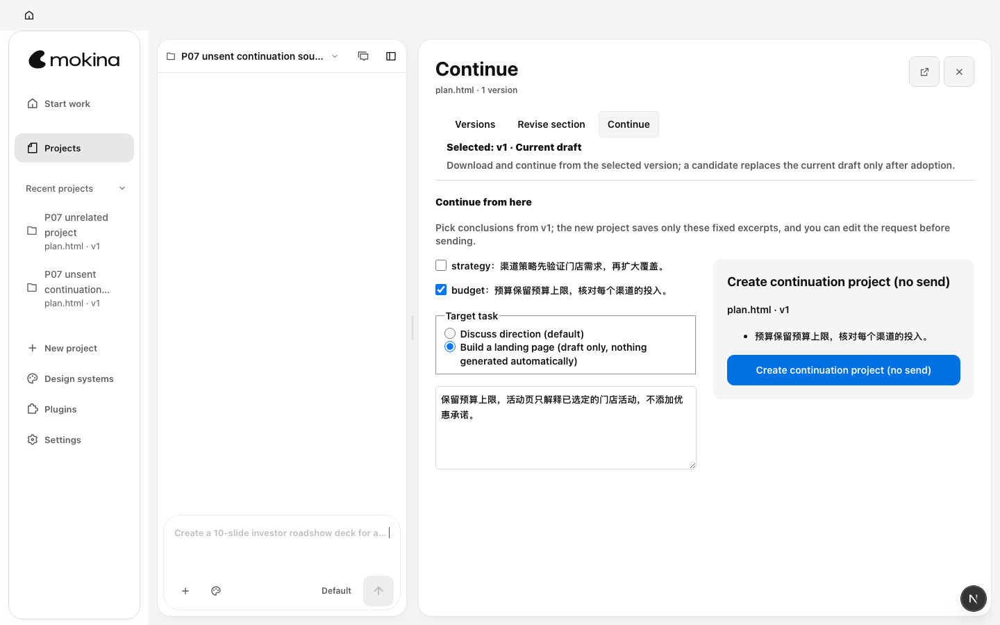
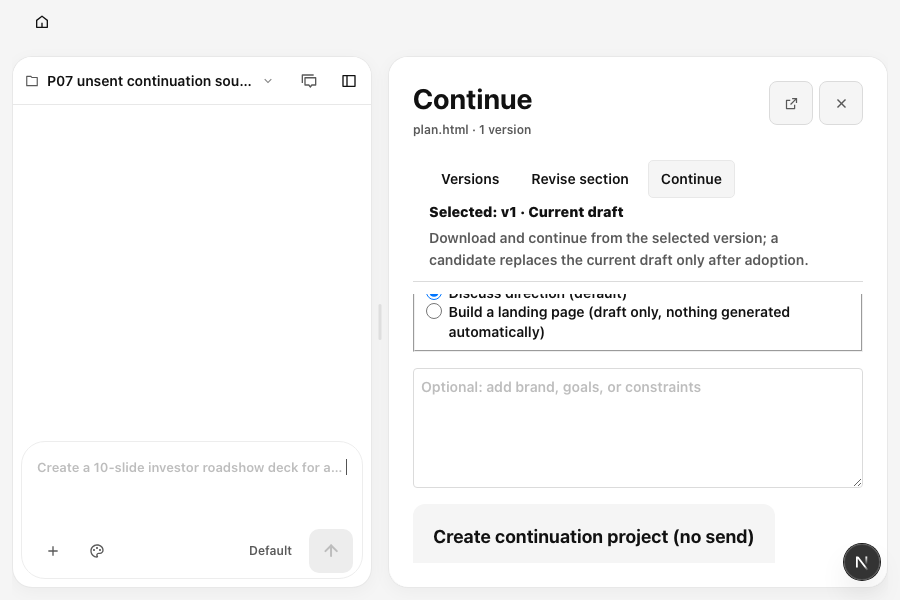
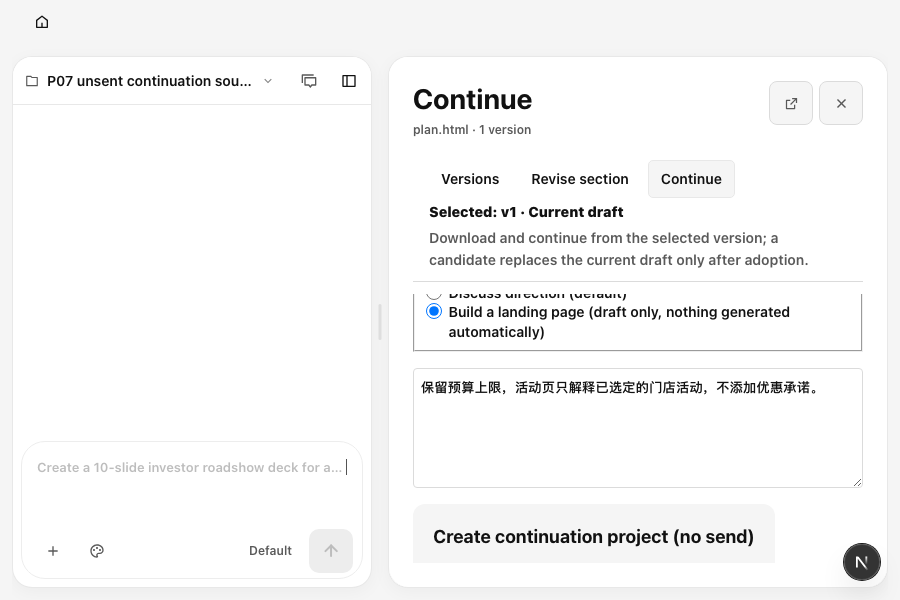

# R01：创建前继续制作草稿

本项修复的是 P07 点击“创建接续项目”之前的准备输入。输入现在能在关闭、刷新、切换项目后恢复；来源失效时保留要求和素材说明，要求用户明确重新选择。恢复草稿不会创建项目或发送制作请求。

## 缺陷与实现

基线 `98851a978840ef84a649379cfe3fa86cb63a8212` 的 P07 将章节选择、背景、目标、素材用途和 BrandKit 选择保存在面板组件 state。关闭面板即卸载该组件，重开后输入变空。浏览器在 1440×900 与 900×600 均复现同一句中文要求丢失；组件红例也在关闭重开处失败。

新记录为 `od:continuation:draft:<workspace/project/file scope>`，保存选定版本 ID、可用的版本摘要、章节 ID、背景、目标，以及素材 SHA-256/用途和 BrandKit 内容摘要。沿用现有 recovery store、本地缓存、原生镜像和 CAS，不新增后台或第二套执行状态。创建后的操作身份、请求结果未知时的恢复与幂等仍由既有 continuation journal 负责；草稿恢复仅恢复输入。

- 素材或 BrandKit 变化、来源版本消失或章节不再存在时，保留文字，阻止创建并显示重新确认入口。素材尚在读取时显示处理中，不误报来源变化；已取消的迟到读取不会覆盖新选择。
- 保存失败保留输入，阻止创建并允许重试；读取失败不会解释为空草稿，不会覆盖原记录，也不妨碍版本阅读。
- 损坏记录只允许在先保存原始备份后重置；竞争窗口已改写记录时不覆盖它。
- 创建前等待草稿写入结束；恢复、重选资料、草稿重试均不触发 runs/projects POST。

## 验证

| 验证 | 结果与证据 |
|---|---|
| 修复前组件红例 | 1/1 按预期失败，关闭重开背景为空；`output/mokina-m0-2026-10-11/r01-red.log` |
| 修复前真实浏览器 | 两视口均按预期失败：期望同一句中文要求，实际空字符串；`r01-browser-before.log` / `r01-browser-before-results.json` |
| R01 组件与既有修订/执行恢复 | 4 个测试文件，66/66 通过；`r01-related-final.log` |
| 最终真实浏览器 | 2/2 通过；关闭重开、刷新、项目隔离、返回恢复，均无 projects/runs POST；`r01-browser-final.log` / `r01-browser-final-results.json` |
| E2E 类型检查 | 通过；`r01-e2e-typecheck.log` |
| 原生持久化边界 | 组件用现有原生 facade 的合成 CAS 存储验证清空 renderer cache 后 hydration 恢复；这不代表原生安装包验收，最终候选重启由主验收单独记录 |

11 个新组件行为用例覆盖背景/章节/制作目标恢复、项目隔离、失效版本、素材摘要变化与说明保留、BrandKit 变化、写入失败、竞争窗口、损坏记录、读取失败和迟到请求，以及 facade 重启恢复。原有 `mokina-continuation-recovery.test.ts` 的“does not rebind consumed inputs when reopening a completed operation”同步通过，保证已消费的创建身份继续由 journal 处理。原有 IPC 失败组件用例增加“创建按钮可用”的等待，以适配新增持久化过程，保留了无 POST、原选择未丢失、schema 3 操作身份等断言。

## 同数据、同视口对照

合成项目名为 `P07 unsent continuation source`，同一 HTML 的 `budget` 章节、同一背景“保留预算上限，活动页只解释已选定的门店活动，不添加优惠承诺。”、同一活动页目标。截图均在关闭重开后、背景输入可见时采集，缩小窗口使用原面板滚动。没有使用真实业务数据或模型模拟成功。

| 视口 | 修复前 | 修复后 |
|---|---|---|
| 1440×900 |  |  |
| 900×600 |  |  |

两视口前后面板尺寸分别为 824×830、498×530，页面横向溢出均为 0，测量见 [p07-geometry.json](./evidence/p07-geometry.json)。修复改变输入的恢复行为，保持布局和品牌规则。

基线使用隔离 managed worktree，生产 FileViewer 保持 `98851a97`；仅复制本次行为用例，并将临时 harness 的 tools-dev 启动指向其自身 checkout，复用依赖。曾发现共享 node_modules 的 bin 指回当前树，该次结果已排除出基线证据。`r01-baseline-identity.txt`、`r01-baseline-harness.patch` 与 runtime 日志记录来源及启动调整。

## 清理与边界

浏览器 harness 已通过生命周期入口停止本项启动的 web/daemon。基线失败资源先保留日志、截图、几何与端口记录，再随本项 managed worktree 归档清理；当前绿例由 harness 清除隔离合成数据。本项未安装、替换或注册任何原生应用，不触碰用户应用及项目数据。

本项没有重新运行模型，没有评价新模型成果质量；既有真实成果的复核在 [营销成果评审](./marketing-quality-review.md)。全局 guard、完整类型检查、构建、CI 与最终原生候选身份由 M0 主交付记录负责。
