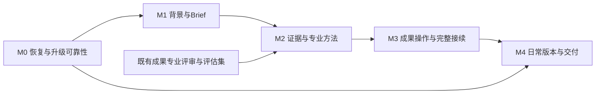

# Mokina：终局差距评估与完整开发方案

日期：2026-10-11。本文记录规划时的差距与完整开发方案；**M0 已获批准实施，M1–M4 保持后续范围**。规划时只读核对产品定义、当前代码、PR、应用身份和已有运行证据；后续 M0 的实际改动及验收状态见 [M0 证据索引](../mokina-m0-2026-10-11/README.md)，不以本文的规划表述代替完成结论。

## 1. 结论

Mokina 已有一条真实可用的生产骨架：从目标和资料出发，生成 HTML，修订章节，比较和采用候选，回看和导出指定版本，再带着固定来源继续制作。它已经超过静态原型阶段。

距离既定终局，主要差距是：**把可靠的生成工作区，补成能够理解长期业务背景、运用营销方法、呈现依据和取舍、持续修改专业成果的日常工具。** 不需要重做 P01–P08，也不需要另建 Agent 引擎。下一轮不宜继续以页面还原或扩大场景按钮数量为主。

建议先收口恢复与升级可靠性，再完成“业务背景与 Brief → 专业研究/策略 → 可操作 HTML 成果 → 固定来源接续”的完整工作链；专业质量验证从第一阶段并行开展，不能等功能全部做完再补。

### 终局的依据与边界

依据最新已确认定义，Mokina 是面向个人营销人员的开源工作区，**项目与交付物优先、弱化会话、以 HTML 统一成果体验、以营销 Skill 和 reference 模板承载专业方法**。[产品定义第 1 节](../reviews/2026-09-23-v0.0.1/产品定义-讨论附件快照.md) 的 2026-09-21 更新优先于文档后部的旧三栏、会话中心和旧配色描述；[B0+B1 Spec](../specs/Mokina-B0-B1-开发Spec-2026-10-03.md) 明确了这一来源关系。视觉沿用 [2026-10-08 设计与行为契约](../specs/Mokina-Brand-UI-Spec-2026-10-08/01-设计与行为契约.md)：黑白品牌、浅色主题、蓝色主操作。

本方案将终局完成定义为六件用户能够实际完成的事：

1. 带一个问题或任务开始，不必先建完整品牌档案或学会选择 Skill。
2. 使用、确认和复用品牌/产品事实，清楚区分事实、假设、个人偏好和本次要求。
3. 得到有依据、有取舍的研究和营销方案，能解释预算、渠道、KPI 与行动之间的关系。
4. 直接操作 HTML 中的具体内容，自己编辑或让 Agent 局部修改，原成果和版本身份保持清楚。
5. 从选定版本和片段继续工作；上游变化不静默改变下游，导出与用户选择一致。
6. 日常切换、退出、重启、恢复和升级后，工作仍可找到、继续和交付。

定位策略、活动方案、执行计划、复盘报告是终局中的成果类型示例，应逐类形成方法、模板和验收标准；不意味着一次实现所有营销专用编辑器。团队权限、企业审批、投放平台、自动发布、视频工厂、Skill 市场、多平台同时发行不属于当前终局闭环的必要依赖。

## 2. 当前基线：哪些已经成立

| 层次 | 当前核对结果 | 证据边界 |
|---|---|---|
| 本轮评估的代码 | `codex/mokina-maturity-recovery`，`98851a978840ef84a649379cfe3fa86cb63a8212` | 评估开始时已跟踪文件干净；历史 output 保留 |
| 主线与 PR | main=`f0e3f8de`；[PR #14](https://github.com/MainQuestAI/Mokina/pull/14) Draft/open，head=`247dbc39`；[PR #15](https://github.com/MainQuestAI/Mokina/pull/15) Draft/open，head=`98851a97`，基于 PR #14 分支 | PR #14 历史 CI 失败；PR #15 最终 CI 成功。主线尚未包含这两批，整合后需验证最终 SHA |
| 现用应用 | `/Users/dingcheng/Applications/Mokina.app`，`0.0.4-local.1` | 不是最新候选，未替换 |
| 最新已验候选 | `0.0.4-local.4`，macOS arm64，对应 `98851a97` | ad-hoc 签名；不是已公证正式发布，也不代表用户签收 |
| 核心行为 | 项目/成果入口、资料固定、候选修订/采用、版本导出、接续与发送恢复均有实现和验证记录 | 并非每条历史验证都在最新包上重跑 |
| 最近可靠性改进 | P05 草稿恢复、快照并发一致性、损坏版本清单保护、CLI 登录探测、会话历史小窗口操作 | [成熟度升级记录](../mokina-maturity-2026-10-11/README.md)、[最终交付](../../output/maturity-2026-10-11/DELIVERY.md) |
| 真实模型与交付 | local.4 一次真实章节修订、候选采用、指定旧版 HTML 原生导出及摘要核对通过；较早版本有两预算/禁投、CSV 复算和三版本×三格式记录 | 最近同包验证不等于全类型专业质量；历史人工策略评审仍待完成 |

不能重新列为“缺失”的能力：Brand Kit 规则冻结、资料选段与位置、真实上下文快照、接续创建后的 journal 恢复、请求未知状态与去重、候选采用、历史版本导出、宿主 Strategy V2 计划和任务持久化。它们是后续开发的基础。

## 3. 差距清单与完成标准

这里的优先级表示开发顺序。代码可见的问题、已复现问题与尚未完成的产品能力分别标明；不以条目数或主观百分比打成熟度分数。

| ID / 优先级 | 当前状态、证据与用户影响 | 需要补齐的能力 | 完成标准 / 批次 |
|---|---|---|---|
| G01 / P1 | 恢复包已实现；`recovery-package.ts` 的版本目录读取异常可返回空，损坏版本可被跳过；导出路由没有传递 `warnings`。静态路径已确认，本次未新建故障复现。用户可能把部分抢救包当成完整备份 | 完整导出、部分抢救、失败有明确区分；内容清单与缺失项可审查 | 权限失败不当空；损坏/缺失不能无提示成功；导入后版本与来源摘要匹配。M0 |
| G02 / P1 | P07 创建前选区、背景、素材在面板状态中，关闭/刷新恢复尚未补齐；创建后的接续 journal 已存在。[升级后续清单](../mokina-maturity-2026-10-11/README.md) | 继续制作表单草稿和来源身份持久化 | 关闭、刷新、重启、项目切换恢复文字和有效选择；失效来源要求重选；不自动创建或发送。M0 |
| G03 / P1 | 现用 namespace=`mokina-local-v004-1`，候选=`mokina-local-maturity-4`。隔离测试正确，但不是连续升级；桌面恢复记录上限 512，计数包括墓碑 | 稳定用户 profile、可恢复的升级路径、恢复记录容量与安全归档 | 在隔离旧 profile 副本上升级；数据、版本、草稿保留；迁移失败可回退；超过容量有恢复出口，旧窗口不能复活删除内容。M0 设计及最小升级路径，M4 完整原生门禁 |
| G04 / P1 | 登录检查已按实际配置解析 CLI；diagnostics 仍走系统 PATH 的独立 `codex --version` 检查，可能矛盾，待故障用例验证 | 设置、登录、诊断和运行共用身份解析，错误能指导下一步 | 自定义 CLI/HOME、PATH 缺失、认证过期分别正确；检测、登录和实际模型执行继续分层。M0 |
| G05 / P1 | 已有用户笔记、品牌规则和固定快照；尚不足以形成已确认业务事实、个人偏好和本次 Brief 的完整生命周期 | 可编辑、可确认、可选择复用的品牌/产品事实与任务 Brief | 任务 A 的临时要求不污染长期背景；修改品牌事实不改旧任务；第二个项目能显式复用，缺档案仍可直接开始。M1 |
| G06 / P1 | 宿主有 `fullPlan`、`plan_only` 和 task-store；Mokina 三个场景主要依赖文字要求，不能据此认定营销 Brief、交付项和计划编辑已完整产品化 | 把目标、缺口、交付项和当前执行范围接到既有计划路径 | 保存计划不制作；讨论不改成果；开始某项只执行所选范围；改计划后旧运行不写回新范围。M1 |
| G07 / P1 | 三个 Mokina Skill 已有原则和 HTML 章节契约；reference 主要是短约定，尚非完整方法/模板/案例包 | 方法与 HTML 模板共同定义研究、定位/策略、活动方案，并记录实际加载版本 | 每包具备输入、判断步骤、证据要求、HTML 模板、正反例、检查项；真实任务证明改变了判断或表达。M2 |
| G08 / P1 | 本地资料解析、固定摘录和实际提交回执已实现；联网依据目前仍依赖 Agent/场景约定，全文阅读、结论对应依据的稳定产品闭环缺验收 | 针对任务的研究依据：原文/搜索摘要区分、时间口径、冲突、未核实项、结论跳转来源 | 无法访问正文时明确限制；不能把摘要称为全文阅读；每个关键外部事实能定位支持摘录，旧报告的证据不漂移。M2 |
| G09 / P1 | 真模型两预算/禁投和 CSV 复算已有历史证据；尚不能证明专业策略取舍稳定，版本差异不等于业务方向比较 | 目标/KPI/预算/行动关联、替代方向比较及选择性组合 | 同资料改变预算或禁投条件会改变行动取舍；合计/单位/口径可复算；组合只形成新候选，保留原方向。M2→M3 |
| G10 / P1 | 章节选择、候选比较/采用及宿主编辑已有；矩阵行、策略条目、图表数据等专业操作未形成统一 Mokina 验收 | 少数成果类型的直接编辑和语义操作，工作/阅读视图共用版本 | 改一项预算能指出受影响合计；只修选定段落其余保持；不用编辑源码；旧 HTML 仍可阅读/章节修订。M3 |
| G11 / P1 | 结构校验只保证可寻址章节；历史数值验证与人工专业评审分开，后者未完成 | 绑定具体版本的质量检查、缺陷清单和定向精修；可重复的专业评估集 | 无编造来源、超预算或违反禁投；策略有依据和取舍、行动可执行；检查问题能定位章节，修复沿候选采用。M0 建评估集，M2/M3 验收 |
| G12 / P2 | 项目成果目录、指定版本 HTML/ZIP/PDF 和本地安装已实现；长期多成果查找、复杂交付矩阵和正式发行仍有边界 | 成果优先的日常导航与正式交付规范；按实际需要再加检索/更多类型 | 不必找聊天才能找到正式成果；长中文/资源/离线文件验证；稳定升级与干净安装通过。轻量导航 M3，交付 M4；全局搜索/来源图谱继续后置 |

## 4. 用户体验开发方案

沿现有页面与控件渐进补齐，不新增第二套工作台。

| 视图 | 本轮路线中的变化 | 必须保留的行为 |
|---|---|---|
| P01 开始工作 | 输入目标后可展开轻量 Brief：已知目标、必要缺项、所选背景、预期成果；说明用户已选方法的用途 | 不强制建档、选方法或走固定步骤；仅讨论不生成；确认式场景推荐 C4 继续后置 |
| P02 项目 | 保留成果入口，按真实数据展示正式稿、待处理候选、当前工作；多成果可就地选择，保留现有列表形态 | 读取失败不等于零成果；候选、历史和附件不混入正式数量；不建复杂看板 |
| P03 工作区 | 目标/Brief 和计划按需展开；突出当前成果与正在修改范围；质量问题可回到具体章节 | 会话是协作及追溯入口；后台完成不抢画布、焦点或草稿；加载/失败/未知/完成有动作出口 |
| P04 资料 | 在既有选择、解析、固定、回执上区分品牌规则、业务事实、研究证据和本次要求；显示来源时间与读取限制 | 选中、固定、已提交、已理解不能混用；无法读取不伪装为空；用户可明确排除 |
| P05 修订 | 保留章节修订，优先支持策略条目、预算表和研究矩阵中的受控局部操作；比较说明业务变化 | 手工保存走原版本机制；Agent 修改是候选；基础版本变更提示冲突；中文草稿与组合输入不丢失 |
| P06 版本与导出 | 为选定版本展示质量检查状态和交付范围；复杂内容导出检查；恢复包和普通成果导出文案分开 | 当前/历史/候选身份始终可见；导出失败不回退到最新版；阅读与交付使用同一版本 |
| P07 继续制作 | 先补创建前草稿；按用户明确选择的研究/策略/活动页用途，预览将带入的事实与片段 | 固定所选来源，不整包复制；确认后创建但不发送；上游变更不自动传播；使用既有 operation/journal |
| P08 活动页 | 保留真实制作能力，补从策略到页面的信息对应、品牌事实和选定素材验收 | 没有真实发布/表单服务时不显示发布或提交成功；Mokina 主题不改变作品配色 |

所有新增面板复用现有 loading/empty/error/unknown/running/completed 表达、恢复 store 和控制器。测试至少覆盖 1440×900、900×600 的同数据对照，并检查常用原生窗口；超出支持范围的窄屏只保证已承诺的可操作性，不据此承诺移动端。自动或确认式方法推荐不作为 M1/M3 的退出门槛。

## 5. 前后端与原生实现方案

### 5.1 保持唯一状态来源

```text
现有 Home / ProjectView / FileViewer / MokinaContextPanel
    ↓ 同一授权、scope、generation、草稿恢复和运行控制器
现有 daemon + contracts + CLI
    ├─ 项目/会话/Run + Strategy V2/task-store
    ├─ 业务背景与 Brief（必要的小型、版本化增量）
    ├─ context-store 固定资料及证据 + delivery receipt
    ├─ 场景 Skill/reference + 实际资源绑定记录
    └─ 原 HTML 文件/版本/候选/采用/导出机制
原生宿主：同一 profile、恢复 CAS、配置解析、包与升级生命周期
```

新增字段先检查既有对象能否承载；只有真实行为需要才扩 contracts。沿 `RUNTIME_DATA_DIR` 和原 project root 管理，不另建数据库、RAG、全局 Work 树或运行引擎。

### 5.2 最小业务契约（以下为拟议增量，不是当前 API）

| 概念 | 最小字段/职责 | 存储、更新与兼容规则 |
|---|---|---|
| 业务背景 | 身份、修订号、事实条目、来源定位、确认状态、适用范围；个人偏好与品牌事实分开 | 优先现有项目元数据/受管理文件；可复用背景由用户明确选择。仅保存可追溯业务内容，不自动把聊天提炼为永久记忆 |
| 任务 Brief | 目标、受众、交付项、KPI口径、预算/周期、限制、缺项、所选背景修订及快照 | 准备中的文字用既有草稿；用户明确保存为成果时写入同一 HTML/版本机制，以 entry/version 引用。面板从该源派生，不另存一份可写正文；未填项保持未知 |
| 研究证据 | sourceId、URL或文件定位、获取时间、原文/摘要、支持摘录、摘要指纹、读取限制；结论的来源映射 | 扩展现有快照/成果引用；固定证据不变，重新研究产生新证据。网页内容不作为系统指令；无需新搜索服务 |
| 计算记录 | 输入快照/数据摘要、字段映射、单位/时间口径、空值与重复值处理、脚本或方法摘要、结果文件及摘要、runId | 沿现有 run 和 supportingFiles 保存，绑定成果版本。运行成功而证据写入失败时只补保存；不重新运行模型或把未复算数值标为已核验 |
| 方法绑定 | 场景/方法ID、版本/内容摘要、实际使用的 reference 及运行身份 | 从 `plugins/apply.ts` 的 `AppliedPluginSnapshot` 和普通场景绑定补实际 reference 内容摘要；不把 Mokina scenario 接成 OD Next 专用 strategy-package。未记录加载不能显示已使用；加载不等于专业合格 |
| 专业检查结果 | projectId、entry、versionId、contentDigest、检查器/规则版本、问题章节、严重性、依据、建议 | 对原成果的派生检查记录，不是另一份成果或 current 指针；版本改变后旧检查仅对旧版有效。人工结论和自动算术检查分开 |
| 继续制作草稿 | project/entry/baseVersion/选区、用户要求、可恢复素材身份、保存修订 | 复用已有恢复 key/CAS/native mirror；不持久化不可恢复 File 句柄为假附件；执行后仍由既有 journal 管理 |
| 恢复包完整性 | complete/partial、已收录清单、缺失项/原因、校验摘要和导出身份 | 默认完整导出遇关键缺失应失败；用户明确选择后才生成 partial 抢救包。采用新 schema 使不支持的旧 reader 拒绝；旧 v1 仍可读，但其完整性标为未证明。partial 需满足可导入的版本/parent/base/来源引用闭包，缺失关系不得伪造 |

业务背景读写扩展既有项目路由，必要的新请求采用 `expectedRevision`；Brief 与营销执行计划作为 HTML 成果沿既有文件/版本接口保存。技术生产计划仍归 Strategy task-store，只引用指定的 Brief/成果版本，不复制其业务正文。两类计划分别回答“Agent 本次怎样制作”和“营销业务接下来怎样执行”。

语义关联优先扩展 `ArtifactManifest.metadata`、`supportingFiles` 和已有来源字段：成果类型、稳定条目/数据集 ID、快照/方法/证据的固定引用；不建立第二成果库。新增证据/计算/检查记录按 operationId 与内容摘要幂等写入，同 ID 改语义返回409，受理结果未知先查询。旧 HTML 缺少可选字段仍可打开、修订和导出，不补造已确认或已检查状态。若引入新业务契约，web、daemon、contracts、CLI 同一 PR 更新，并给出成功、409冲突、无法读取、旧数据兼容示例。

**不把营销语义塞入共享 Strategy V2 协议。** 该协议明确排除 `qualityGate`、`evidencePlan`、`critique` 等语义。专业检查作为 Mokina 指定成果版本的检查记录，执行仍使用已有 run；不为质量功能另造工作流状态机。

### 5.3 HTML 是成果源，避免两份内容互相覆盖

首批继续以原 HTML 文件及版本为正式成果源。受控条目编辑、预算表修改等操作写回同一个 HTML 版本；稳定章节 ID 延续。不要同时建立独立、可写的“营销 JSON 文档”和 HTML 作为两套正文。

模板需要的结构化数据可采用 HTML 内稳定标记/嵌入数据，并在一次保存中原子更新对应可见内容；如某类型确需独立计算数据文件，应先明确唯一可写源和生成规则，不能由 UI 与 Agent 分别修改两个副本。最初只支持少数明确操作；通用任意 HTML 可视化编辑不作为前置任务。缺少新标记的旧成果继续使用阅读和章节修订。

Agent 的方向组合、质量修复、图表更新均绑定 baseVersion/选区并产生候选。采用使用现有冲突检查。预览 iframe 的内容不能直接调用原生写入、采用或发布，操作仍由宿主校验后执行。

证据、计算输入/结果和检查记录不能只引用会被覆盖的 `supportingFiles` 路径。现有版本保存会冻结 HTML 及其可识别资源，但不会自动冻结通用计算附件，这部分是明确的开发增量。为指定版本保存不可变的引用清单及各成员摘要，附件使用现有冻结资源/项目受管理路径；准备附件并校验完成后，沿原版本保存及恢复机制发布关联。中途失败保留可核对的原 operation 和产物，只补未完成的保存，不重新运行模型。读回、导出及恢复包均验证该版本的引用闭包；缺失或摘要不符明确失败，不能用当前文件顶替历史附件。

新增记录的恢复 manifest、摘要校验和归属映射必须与 R07/R09 同期交付，不能留到 M4 再补。当前恢复导入按固定字段重建版本，不能靠复制 supportingFiles 自动恢复新关联；用恢复 owner wrapper/映射保留原来源身份及摘要，不重写原快照的 fingerprint。两个必要红例：v1 保存后同名计算附件被改写，v1 阅读/导出仍使用原证据；恢复到新项目后，离线仍能查证据、复算并查看指定旧版检查。

### 5.4 可靠性和资源生命周期

- 所有新发送和变更继续用 `clientRequestId` / `operationId`、现有去重与 journal；超时是 unknown，不自动换 ID 重发。
- 运行恢复指核对已受理请求和已保存结果，不承诺模型计算断点续跑。现有 daemon 重启中断可明确结束为 failed/`DAEMON_RESTARTED`；用户核对后显式重新执行才产生新的 run，旧结果不冒充新任务完成。
- 背景修改只影响未来选择；已经固定的 snapshot 和下游成果不变。失效来源不降级为整份或最新版本。
- 页面切换、账户/工作区变化、旧请求返回继续通过现有 generation/authority 丢弃过期结果；只读失败不写入空集合。
- 恢复包先做故障红例，明确目录不可读、条目损坏、缺文件、导出中变更的结果；不要只加一个“有警告”标签而仍保证完整备份。
- 恢复 store 容量治理先显示容量及可处理记录，再在有兼容设计时做归档/压缩。墓碑承担防旧缓存复活职责，不能简单 TTL 清除；压缩需 generation/epoch 或等价见证，旧客户端恢复前重新协调。
- 正式 profile 与版本号解耦，测试 namespace 继续隔离。从现用数据升级先使用副本验证，保留原 profile；禁止自动扫描合并所有历史候选数据。R04 明确支持的 source→target profile/schema 清单，排除活跃写入者；通过完整校验后才切换目标，迁移中断不能暴露半份数据，原 profile 保持可用。

### 5.5 主要修改入口

| 模块 | 既有入口 | 修改范围 |
|---|---|---|
| 前端 | `apps/web/src/components/{HomeView,ProjectView,FileViewer}.tsx`、`apps/web/src/components/mokina/MokinaContextPanel.tsx`、`apps/web/src/artifacts/mokina-project-entry.ts` | Brief/证据/局部操作与状态展示；沿现有组件边界，避免继续堆叠无关功能 |
| 恢复 | `apps/web/src/runtime/persistence/mokina-recovery-store.ts`、`apps/web/src/runtime/mokina/{continuation-recovery,recovery-package-client}.ts` | P07 草稿、包完整性提示；既有恢复身份不变 |
| 后端 | `apps/daemon/src/mokina/{context-store,materials,recovery-package}.ts`、`apps/daemon/src/{project-file-versions,import-export-routes}.ts` | 固定业务/研究依据、备份完整性、版本绑定检查 |
| 策略/方法 | `apps/daemon/src/strategies/task-store.ts`、`apps/daemon/src/plugins/apply.ts`、`plugins/_official/scenarios/mokina-*` | 技术计划沿 task-store；营销方法身份沿普通插件快照；方法和模板在场景资源中增加 |
| contracts | `packages/contracts/src/api/{mokina-context,mokina-recovery,artifacts}.ts`、既有项目/版本契约 | 只扩必要语义与兼容验证，不复制共享运行协议 |
| 原生/打包 | `apps/desktop/src/main/mokina-recovery-store.ts`、`apps/daemon/src/mokina/codex-connection.ts`、`apps/daemon/src/routes/project/index.ts`、`apps/packaged/src/config.ts`、`tools/pack/resources/mokina-product.json` | CLI身份、profile迁移、恢复容量、版本/构建/发行身份 |

以上代码路径相对 `open-design/`；花括号仅压缩列出同目录文件。实施前读取模块 AGENTS，并沿实际导入关系修改。

## 6. 分批开发与依赖

阶段编号是本方案的里程碑，不等同历史 B0–B4、N00–N08 或软件版本号。按完成门槛推进，不在范围未估实前承诺日历日期。

| 批次 | 用户能感知到的结果 | 具体任务与 PR 切片 | 退出门槛 |
|---|---|---|---|
| **M0：可持续工作的底线** | 继续制作草稿保留；备份是否完整说清楚；连接诊断可信；升级有数据保留路径 | R01 P07 草稿；R02 恢复包完整性；R03 CLI诊断统一；R04 稳定profile/迁移设计及最小实现。同步整理 PR14→15 整合顺序和专业评估集 | 四项各有失败/恢复证据；受支持旧profile副本完成迁移、写入排除和中断回退；未解决的数据风险不能包装成普通升级。完成代码不等于授权合并 |
| **M1：理解业务与执行范围** | 同一品牌第二次做任务不用重新解释；任务要求和长期事实不串；用户明确知道当前做什么 | R05 背景确认/复用；R06 Brief与既有计划联动、保存/开始边界 | 无背景直接开始、已确认背景复用、任务变更、项目切换四条真实流程通过；不重建计划引擎 |
| **M2：专业研究和策略成立** | 研究有可查依据，策略有预算/KPI逻辑与取舍，输出不是通用长文 | R07 证据/计算及版本冻结；R08 首批方法/reference模板；R09 版本绑定检查与真实质量评估；新增记录的恢复包兼容随各切片交付 | A/B/C 中研究、约束、预算/KPI和计算子集通过；历史附件防漂移及离线恢复通过；验收集硬性错误为零；人工专业结论有实际评语。方向组合与完整跨类型接续留 M3 |
| **M3：成果能够持续操作** | 直接改策略项/预算/矩阵；比较方向、定向精修；找到成果即可继续工作 | R10 首批语义操作和候选比较；R11 研究→策略→活动页完整接续与轻量项目成果导航 | 补齐 A/B/C 的组合、语义编辑与接续；上游变更/下游恢复通过；成套交付完整且关键事实一致；读写与导出同版本；不扩成任意HTML编辑器 |
| **M4：可交付的日常版本** | 安装、升级、恢复与导出可预测，有清楚的支持范围 | R12 同包交付/兼容矩阵；R13 稳定安装与发布工程；恢复容量归档/压缩闭环 | 干净安装及旧profile副本升级通过；最终SHA/CI/包一致；原生同包关键链、导出和清理齐备；正式发布另行取得授权 |

关键依赖：



可并行项：M0 的前端草稿、后端恢复包、原生诊断/profile；M1 的契约确定后，方法/reference 内容可以与界面并行；M2 的证据和模板在共同输入契约冻结后并行。共享版本、发送、采用或迁移契约必须由同一主线协调。每个 PR 围绕可独立验证的行为，不按“前端全部完成后再补后端”拆分。

PR #14/#15 尚未合并不妨碍准备后续切片；开发应选明确依赖分支或隔离 worktree，保留原工作。整合需要检查最终目标分支、重跑受影响测试；本方案不构成合并或发布授权。

## 7. 首批专业方法与成果范围

五个方法单元复用三个现有场景入口，不增加五个必须经过的步骤。

| 方法单元 | 核心判断 | HTML reference / 操作 | 第一批验收 |
|---|---|---|---|
| 背景理解与 Brief | 哪些是事实，缺什么会改变判断，本次交付范围是什么 | 目标/约束/缺项摘要，可确认与修改 | 一次要求不变成永久品牌规则；缺项不编造 |
| 市场与竞争分析 | 比较对象和口径、关键证据、冲突、对当前决策的含义 | 研究矩阵、定位/对比图、结论旁来源展开 | 每个关键外部事实可定位，来源不足时降低结论强度 |
| 定位与 KPI 策略 | 受众/价值主张、替代路径、资源与目标能否支持选择 | STP/价值主张关系、方向比较、预算与行动表 | 不为填模板机械套理论；预算和限制改变时取舍改变 |
| 方案组织与接续 | 把选择变成行动、时间、资源与验证安排 | 营销方案；选定结论进入已有活动页制作 | 任务足够具体，策略和页面主张一致；没有后端不伪造表单成功 |
| 检查与精修 | 哪处缺依据、矛盾、不可执行或表达不清 | 绑定版本的问题清单、章节定位、候选比较 | 问题是具体可修的；不用虚构专家打分；无收益时停止迭代 |

每个方法包必须同时提交：适用/不适用条件、输入及缺项处理、步骤与取舍、证据约定、可运行 HTML 模板、稳定章节/操作映射、正反例、资源许可及版本摘要、行为和质量用例。只有文案更长或安装了更多 Skill 不算完成。

首批之后再逐类扩展：执行计划深化、复盘报告、内容组合包等。每增加一种类型，都沿同一输入/来源/版本/导出体系交付。可编辑 PPTX/DOCX、OCR/复杂 Office、全局搜索/来源图谱必须有具体任务驱动，再单独确定范围；不能反过来成为第一条工作链的前置工程。

## 8. 验证与专业质量门槛

优先使用已有完整真实输出做专业评审，找到问题后才做对应重跑。确定性故障可用 fixture；专业能力必须用真实模型和真实产物。合成/公开任务可先跑；客户私有事实、素材和模型目的地在具体使用前确认范围。

| 验收任务 | 必须完成的工作 | 可核验结果 |
|---|---|---|
| A：从问题到研究 | 同一问题提供足够资料、部分冲突、正文不可访问三种情况；形成并修改报告 | 来源/时间/范围准确；事实与推断分开；冲突和未知不被抹掉；局部修改只动所选内容 |
| B：从品牌任务到方案 | 同一资料分别改变预算、禁止渠道、周期；保存计划后选择执行一项；比较/组合方向 | 不超预算、不绕过禁投；方案改变不只是替换数字；KPI有口径与假设；原方向、候选和正式稿身份正确 |
| C：从数据到行动 | 小 CSV 包含缺失、零值、不同单位/时间；按可复算方式分析，选结论继续策略 | 计算可复现，不把缺失当零；来源位置和公式明确；下游只带选定结论和必要背景 |
| D：日常连续工作 | 创建前草稿→关闭重开→项目切换→来源变化→失败/unknown→恢复→升级副本 | 无草稿丢失、错误项目覆盖、重复执行或自动重发；旧profile数据可继续打开 |
| E：交付与回溯 | 当前/历史/候选×HTML/ZIP/PDF；长中文、表格、图表、图像/相对资源、取消、缺资源 | 所选版本及内容一致；应用外可打开；未支持能力明确；恢复包缺失不得无提示成功 |

专业评审看五个维度：约束遵守、判断取舍、事实来源、行动可执行、成果可读。对每项记录具体章节与理由。编造来源、违反禁止条件、预算超限/不守恒、把估算说成已实现属于硬失败。M3 另验成套完整性：约定交付项不遗漏，品牌事实、优惠、KPI口径、时间与 CTA 跨成果一致；不能以单件平均质量抵消整套矛盾。现有 [quality-rubric](../specs/Mokina-v0.0.2-Local-Preview-Spec-2026-10-04/fixtures/quality-rubric.json) 可用于一致记录，但不以自动总分代替专业结论。

证明新增方法有效时，保持资料、模型、任务条件和可用工具一致，执行及检查预算可比，对基线与新方法产物做隐去版本标签的配对评审；记录改善、退步和不确定项。使用额外检查资源获得的改善单独归因，不能全部算作方法增益。功能修复不必每次重跑全部模型任务；方法变更必须覆盖受影响的专业样例。

工程门禁：每个切片通过 `pnpm guard`、工作区类型检查、涉及文案的 i18n、相关构建与行为回归。新缺陷先建立能失败的测试，再修复。最终有一轮独立缺陷审查；新修复只复跑受影响范围，最终 CI 绑定最终 SHA。

原生相关改动使用临时应用和隔离数据，普通切片只验证受影响行为，不为每次回归重新打包或调用模型。**M4 最终候选门禁**至少完成干净安装、旧profile副本升级、重启恢复、窗口/键盘与中文输入、真实模型一次完整任务、指定版本导出。记录真实视口、包版本、源码 SHA、摘要及数据归属；Linux CI 不代替原生验收。

性能验证采用逐步增长的合成项目、成果和长文档，记录列表打开、切换、保存、导出时间及内存/磁盘变化。先建立当前基线，再给出可支持的容量；不能用“支持海量项目”替代测量。不新增遥测平台。

## 9. 发行、迁移与支持范围

第一条可交付路线建议继续以 **macOS arm64、本地个人使用、现有 Codex 路径、HTML/ZIP/PDF** 为保证范围；这不要求删除其他宿主功能或 provider，只是不把未经 Mokina 验收的能力列为保证支持。

PDF 现有历史验收包含图像型输出，不承诺正文可搜索/复制。若实际交付必须满足文字可选、无障碍、复杂分页，应独立开导出质量切片，避免在成熟度结论中隐去限制。

升级流程：检查来源/目标版本与profile → 保存可校验恢复点 → 在副本上迁移和读回 → 确认保留范围及回退条件 → 经授权替换现用应用。项目恢复 ZIP 不包含凭据、app-config 和可执行会话/发送意图，不能宣称整机迁移；设置和会话是否迁移必须按真实 schema 单独处理，pending/unknown 恢复不能触发重发。

正式发行之前确定稳定 bundle/profile 身份、Developer ID/公证及渠道。先把手动升级做可靠，再决定是否启用宿主已有自动更新；启用时验证下载校验、中断、迁移失败回退与旧版兼容，不另建 updater。跨平台属于独立适配矩阵。

每次候选提供同一份交付清单：最终 SHA、PR/目标分支、版本、产品/namespace身份、包摘要、CI与同包验收、已知限制。测试后保存证据，再清理本轮进程、端口、临时应用、挂载及 LaunchServices 注册；保留用户应用、数据和交付包。

## 10. 建议立即进入的开发批次

**选 M0 为下一批，并同步完成现有真实成果的专业评审。** 边界是 P07 创建前草稿、恢复包完整性、诊断身份一致、稳定 profile 最小升级路径；不加入新营销场景或大规模 UI 重构。

这批结束后，用户应能可靠地继续未完成的工作、知道备份是否完整，并在升级时保留数据。专业评审会给 M1/M2 提供具体失败样例，决定先补哪类判断、依据和模板，而不是凭印象扩充方法库。

无需现在重新决定的事项：To C 开源定位、OpenDesign 底座、项目/成果中心、HTML、既有品牌和版本/来源契约。后续仅在相应阶段需要确认：替换现用应用与迁移实际数据、使用客户资料的具体范围、正式签名/发布渠道、专业成果的最终验收。未得到这些确认，不妨碍隔离开发、合成案例验证和候选准备。

### 主要证据入口

- [最新产品定义](../reviews/2026-09-23-v0.0.1/产品定义-讨论附件快照.md)、[行为与来源优先级](../specs/Mokina-B0-B1-开发Spec-2026-10-03.md)、[最新品牌与交互契约](../specs/Mokina-Brand-UI-Spec-2026-10-08/01-设计与行为契约.md)。
- [当前修复与后续清单](../mokina-maturity-2026-10-11/README.md)、[最终 SHA / CI / 同包交付](../../output/maturity-2026-10-11/DELIVERY.md)。
- [历史真实预算、资料、导出与验收边界](../mokina-v0.0.3/2026-10-07-local10-closeout-verification.md)、[专业质量方向及纠偏](../Mokina-v0.3-产品方向收敛与专业质量体系.md)。
- [研究场景](../../open-design/plugins/_official/scenarios/mokina-market-analysis/SKILL.md)、[营销方案场景](../../open-design/plugins/_official/scenarios/mokina-marketing-plan/SKILL.md)、[活动页契约](../../open-design/plugins/_official/scenarios/mokina-landing-page/references/landing-page-contract.md)。
- [上下文契约](../../open-design/packages/contracts/src/api/mokina-context.ts)、[Strategy V2](../../open-design/packages/contracts/src/plugins/strategy-v2.ts)、[HTML章节检查](../../open-design/apps/daemon/src/mokina/deliverable-structure.ts)。
- [恢复包收集](../../open-design/apps/daemon/src/mokina/recovery-package.ts)、[导出路由](../../open-design/apps/daemon/src/import-export-routes.ts)、[桌面恢复容量](../../open-design/apps/desktop/src/main/mokina-recovery-store.ts)、[原生profile解析](../../open-design/apps/packaged/src/config.ts)。

本次规划没有创建临时服务、应用或测试数据，无新增运行资源需要清理。仅新增本文，已有代码和验证资料保持。
